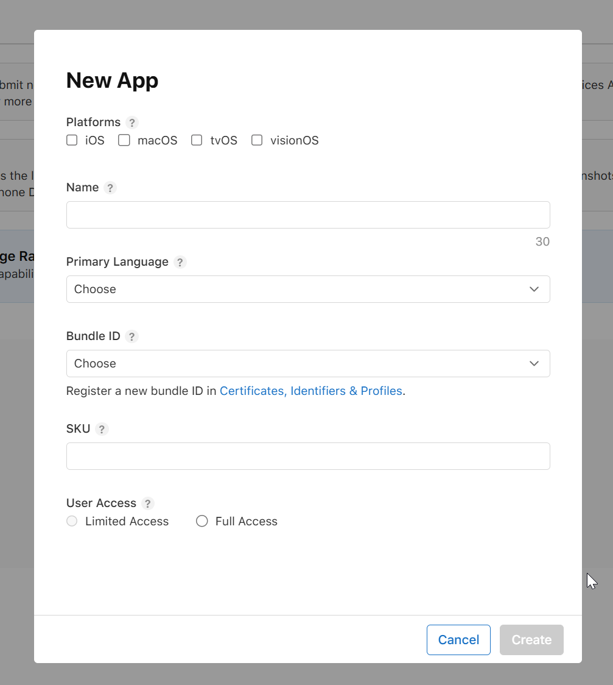

# SoleCount on a Mac, step by step

One path, in order. You are new to the Mac. Apple is still processing the paid Developer membership (up to 48 hours). You can build and run SoleCount today. You upload it after Apple's welcome email.

Do every command on the Mac. Copy a grey box by hovering and clicking the copy icon (two squares), or select the text and press Cmd + C. Click inside Terminal, press Cmd + V, then press Return.

<a id="contents"></a>

## 0. Contents

- [ ] [1. Mac basics](#mac-basics)
- [ ] [2. Get the code](#get-the-code)
- [ ] [3. Set up with no Apple membership](#setup-local)
- [ ] [4. Run the tests](#make-test)
- [ ] [5. Run the app](#run-the-app)
- [ ] [6. Find your Team ID](#team-id)
- [ ] [7. Create the API key and find the .p8 file](#find-the-p8-file)
- [ ] [8. Save the Apple answers and register the bundle ID](#make-setup)
- [ ] [9. Check the New App form](#new-app-form)
- [ ] [10. Attach the $0.99 purchase to version 1.0](#pro-purchase)
- [ ] [11. Send the app to Apple](#make-deploy)
- [ ] [12. Get later updates](#get-updates)
- [ ] [13. Troubleshooting](#troubleshooting)
- [ ] [14. Ask Claude Code](#claude-code)
- [ ] [15. Command cheat sheet](#cheat-sheet)

<a id="part-a"></a>

## Part A: Get ready (one time)

<a id="mac-basics"></a>

### 1. Mac basics

**1. Open this page in Safari.** Click the compass icon in the Dock (the row of icons at the bottom of the screen). Click the address bar, type `github.com/KrishnaDistributedcomputing/SoleCount`, and press Return.

**Why:** You copy commands from this page. A Mac cannot paste text that was copied on a Windows PC.

**2. Open Terminal.** Hold the Cmd key (⌘, next to the space bar) and press the space bar. Type `Terminal` and press Return. A window with a blinking cursor opens.

**Why:** Terminal is where you type instructions. SoleCount's setup tools run there.

**3. Copy a command.** Hover over a grey box and click the copy icon, or drag across the text and press Cmd + C.

**Why:** One wrong character can make a command fail.

**4. Paste and run it.** Click inside Terminal, press Cmd + V, then press Return.

**Why:** Pasting only puts the text in. Return tells the Mac to run it.

**5. Wait.** When the blinking cursor comes back on a new line, the command is finished. If the Mac asks for your password, type it and press Return. Nothing appears while you type. That is normal.

**Why:** Each command builds on the one before it. The password check is macOS asking permission to install tools. The characters stay hidden for security.

Press Cmd + Tab to switch between Safari and Terminal. In Finder, press Cmd + Shift + . to show folders whose names start with a dot. Press it again to hide them.

<a id="get-the-code"></a>

### 2. Get the code

If you do not have a SoleCount folder yet:

```bash
cd ~/Desktop && git clone https://github.com/KrishnaDistributedcomputing/SoleCount.git && cd SoleCount
```

**Why:** This downloads SoleCount onto the Desktop and moves into that folder. Later commands only work inside it.

The first time you use `git`, a window may say **Install command line developer tools**. Click **Install**, wait, then run the command again.

**Why:** Those tools include `git`. The Mac does not include them until you install them.

If the folder is already there, update it instead of cloning again:

```bash
cd ~/Desktop/SoleCount && git pull
```

**Why:** `git pull` downloads the newest saved copy of the branch you are on.

This guide may still be on the branch `cursor/setup-without-apple-043d` and not yet on `main`. If `git pull` on `main` does not show these steps, switch to that branch:

```bash
git checkout cursor/setup-without-apple-043d && git pull
```

**Why:** `git checkout` switches which copy of the project this folder is using. After the branch is merged into `main`, go back with `git checkout main && git pull`.

To throw away a broken copy and start over, only if you have not saved notes inside that folder:

```bash
cd ~/Desktop && rm -rf SoleCount
```

Then run the clone command again.

**Why:** `rm -rf` deletes that folder. The `.p8` key is stored outside it, in your home folder, so this does not delete the key.

<a id="part-b"></a>

## Part B: Do now, no Apple membership needed

You do not have a Team ID, Key ID, Issuer ID, or `.p8` file yet. You do not need them for this part.

<a id="setup-local"></a>

### 3. Set up the Mac

```bash
make setup-local
```

**Why:** This installs the tools, creates the Xcode project, downloads the iPhone Simulator if it is missing, and opens Xcode. It skips every Apple question.

`make setup-local` only runs `scripts/setup_mac.sh --no-apple`. These are the steps, in order:

1. **Checks Xcode 26.** Xcode is Apple's app-building program. Apple only accepts uploads built with Xcode 26, so SoleCount cannot be sent to the App Store with an older Xcode. Skip: no.
2. **Installs Homebrew if it is missing.** Homebrew installs other developer tools. On a new Apple-chip Mac it also tells Terminal where Homebrew lives. It may ask for your Mac password. Skip: no.
3. **Installs XcodeGen.** XcodeGen builds `SoleCount.xcodeproj` from `project.yml`. That project file is not stored on GitHub, so it has to be made on your Mac. Skip: no.
4. **Installs fastlane with Homebrew.** Fastlane is a Ruby tool. This script does not run `bundle install`. Later, `make appstore-setup` and `make deploy` use fastlane. Skip: no.
5. **Creates `fastlane/.env`.** This is a private settings file. Git ignores it, so it is never uploaded to the public GitHub. A blank file is fine today. Skip: no.
6. **Skips the Apple questions.** Team ID, API Key ID, Issuer ID, the `.p8` file, Apple ID email, and the App Review phone and email. `make setup` asks these later. Skip: yes, until Apple's email.
7. **Leaves the Team ID blank** in `Config/Team.xcconfig`. The simulator does not need a Team ID. Skip: yes.
8. **Builds `SoleCount.xcodeproj`.** Xcode opens that file. Skip: no.
9. **Downloads the iPhone Simulator if none is installed, then opens Xcode.** A simulator is a pretend iPhone on your Mac. `make test` and Cmd + R use it. Skip: no.

When it finishes, it lists the skipped Apple items and tells you to run `make test`, then press Cmd + R.

<a id="make-test"></a>

### 4. Run the tests

```bash
make test
```

**Why:** This runs SoleCount's tests in the iPhone Simulator. No Team ID is required. It catches bugs before Apple's reviewers do.

The command prints `Running tests in the iPhone Simulator. No Apple Team ID is needed.` Then fastlane runs the unit tests and the UI tests. The screenshot test is skipped. The usual simulator name is `iPhone 17 Pro Max`. It can take about 10 minutes. A passing run ends with the tests passed.

<a id="run-the-app"></a>

### 5. Run the app

```bash
make open
```

**Why:** This rebuilds the Xcode project from `project.yml` and opens it.

In Xcode, press Cmd + R.

**Why:** Cmd + R builds SoleCount and shows it in the simulator. The $0.99 purchase can be tried there because the project includes `SoleCount.storekit`, a local pretend store. That is not the real App Store.

Optional: install it on your own iPhone with a free Apple ID.

1. In Xcode, open Settings, then Accounts, and add your Apple ID.
2. Click the SoleCount project, open Signing & Capabilities, and choose your Personal Team.

**Why:** A free Apple ID can put SoleCount on your own phone. That install expires after 7 days. It cannot use the In-App Purchase sandbox, and it cannot upload to TestFlight.

<a id="part-c"></a>

## Part C: After Apple's welcome email

Stop here until Apple emails you that the paid membership is active.

<a id="team-id"></a>

### 6. Find your Team ID

Open [developer.apple.com/account](https://developer.apple.com/account), then **Membership details**. Copy the 10-character Team ID.

**Why:** SoleCount's upload tools need it to show Apple which developer account is yours.

<a id="find-the-p8-file"></a>

### 7. Create the API key and find the AuthKey .p8 file

This file lets SoleCount sign in to Apple without your Apple ID password. The name looks like `AuthKey_ABC123DEFG.p8`. The letters after `AuthKey_` are the Key ID.

**1. Sign in.** Open [https://appstoreconnect.apple.com](https://appstoreconnect.apple.com) in Safari.

**Why:** This is the site SoleCount's upload tools talk to.

**2. Open the keys page.** Click **Users and Access**, then the **Integrations** tab, then **App Store Connect API**, then **Team Keys**.

**Why:** This is the only page that can make the key `make setup` asks for.

**3. First visit only.** If you see **Request Access**, click it and accept the terms.

**Why:** Apple hides the key list until you accept those terms.

**4. Generate the key.** Click **+** (**Generate API Key**). Name it `SoleCount`. Access: **Admin**. Click **Generate**.

**Why:** `make deploy` signs the upload with this key. That cloud signing needs an Admin key. App Manager can manage the app, but it is not enough for that signing step.

**5. Copy two codes.** The Key ID is the 10-character code in the list. The Issuer ID is the long code above the table.

**Why:** `make setup` asks for both. The Key ID is also the middle of the file name.

**6. Download the key.** Click **Download API Key**. Apple lets you download this file only once.

**Why:** The download is the private half of the login. If you miss it, you must revoke that key and make a new one.

**7. Find it in Downloads.** Safari saves it there.

- Finder: click the blue-and-white face in the Dock, then **Downloads**. Or press Cmd + Option + L.
- Spotlight: press Cmd + Space and type `AuthKey`.

```bash
ls ~/Downloads/AuthKey_*.p8
```

```bash
mdfind -name AuthKey_
```

**Why:** The first command lists the file in Downloads. The second searches the whole Mac. You need the path when setup asks you to drag the file into Terminal.

**8. Check the safe copy after setup.** Setup copies the file to `~/.appstoreconnect/private_keys/`, outside the SoleCount folder, so it is never uploaded to the public GitHub. `.gitignore` also ignores names that start with `AuthKey_`.

```bash
ls ~/.appstoreconnect/private_keys/
```

**Why:** You should see the `.p8` file there after step 8. Never put that file inside the SoleCount folder.

If Safari saved it as `.p8.txt`, rename it so the name ends in `.p8` only. Do not edit the text inside. If you downloaded it on a Windows PC, AirDrop will not carry it. Use iCloud Drive, a USB stick, or email it to yourself, save it on the Mac, then delete the email and the USB copy. The file is secret. If you lost it, revoke that key in App Store Connect and generate a new one. The Issuer ID does not change.

<a id="make-setup"></a>

### 8. Save the Apple answers, then register the bundle ID

```bash
make setup
```

**Why:** This runs the same tool install as `make setup-local`, then asks for the Apple details and saves them. Press Return only for a question you still do not have.

Answer in this order. The words in Terminal match these:

1. **Team ID** (10 characters, from Membership details).
2. **API Key ID** (10 characters).
3. **Issuer ID** (the long code above the keys table).
4. **The .p8 file.** If the Key ID is filled in, drag `AuthKey_XXXXXXXXXX.p8` from Finder into Terminal and press Return. Or type `~/Downloads/AuthKey_XXXXXXXXXX.p8` with your real Key ID. If the file is already in Downloads under that exact name, the script moves it for you.
5. **Apple ID email.** Optional. Press Return to skip. If you type it, fastlane can create the app record and the privacy answers later. If you skip it, you use the website in step 9.
6. **App Review phone**, with country code, such as `+1 416 555 0100`. Press Return to skip. You will need it before review.
7. **App Review email.** Press Return to skip. You will need it before review.

**Why:** The Team ID is written into `Config/Team.xcconfig`. The key file is copied to `~/.appstoreconnect/private_keys/`. The other answers go in `fastlane/.env` or the review contact files. None of the secret files are committed.

Then:

```bash
make appstore-setup
```

**Why:** This checks that the Team ID, Key ID, Issuer ID, and `.p8` file are really on this Mac. Then fastlane registers the bundle ID `com.krishnav.SoleCount` if it is missing. The script says In-App Purchase is on by default for that new ID. That ID must match `project.yml` and `fastlane/Fastfile`.

Apple does not let the API key create the app record. After the bundle ID exists, one of these happens:

- You skipped the Apple ID email. The command stops and tells you the app record does not exist yet. Fill in the form in step 9. The command's own example uses the name `SoleCount: Sneaker Tracker` and the SKU `solecount-ios`. On the form, use the values in step 9. `solecount001` is fine.
- You typed the Apple ID email. Fastlane signs in as you, asks for a verification code, and creates the app. The name comes from `fastlane/metadata/en-US/name.txt`, which is `SoleCount: Sneaker Tracker`. The SKU it sends is `solecount-ios`. If SoleCount is already in the Apps list, do not create it again.

When the app record exists, the same command sets the app price to free, sets where it can be sold, sets the age rating, and creates the $0.99 purchase `com.krishnav.SoleCount.pro`. If the Apple ID email is saved, it also sends the privacy answers (SoleCount collects no data). If not, it tells you to set App Privacy on the website.

<a id="new-app-form"></a>

### 9. Check the New App form

If SoleCount is already in the Apps list, skip this form. `make appstore-setup` already created it, or you created it earlier.

If the command stopped because the app record does not exist, open this form. This is the empty form:



**0. Open it.** In Safari, open [https://appstoreconnect.apple.com](https://appstoreconnect.apple.com). Click **Apps**. Click the blue **+** next to Apps, then **New App**.

**Why:** This creates the App Store record for SoleCount. The paid membership has to be active.

**1. Platforms.** Tick **iOS** only.

**Why:** SoleCount is an iPhone app.

**2. Name.** Type `SoleCount`. Stay at 30 characters or fewer. If Apple says that name is already being used, type `SoleCount: Sneaker Tracker`. You can change the name later, before release.

**Why:** This is the public App Store name. Fastlane's metadata file already uses `SoleCount: Sneaker Tracker`.

**3. Primary Language.** Choose **English (U.S.)**.

**Why:** SoleCount's App Store text is written in that language.

**4. Bundle ID.** Pick `com.krishnav.SoleCount`.

**Why:** The installed app, the $0.99 purchase, and this listing must share that ID. A different ID would be a different app.

If it is not in the list, `make appstore-setup` should have registered it. Run that command, then refresh this page. Or register it by hand: click **Certificates, Identifiers & Profiles**, then **Identifiers**, then **+**, then **App IDs**, then **App**. Description: `SoleCount`. Bundle ID: **Explicit**, `com.krishnav.SoleCount`. Tick **In-App Purchase** if it is listed. It is on by default for a new App ID. Continue, then Register. Come back and refresh.

**5. SKU.** Type `solecount001`.

**Why:** SKU is a private ID only you see. You cannot change it later. SoleCount's tools find the app by the bundle ID, not by the SKU. If fastlane already created the app, it stored `solecount-ios` instead. Leave that one alone.

**6. User Access.** Choose **Full Access**.

**Why:** You are the only developer. Full Access means everyone on your team can see SoleCount. Limited Access is for a large team.

**7. Click Create** when the button turns blue.

**Why:** This saves the record so the upload has somewhere to go.

<a id="pro-purchase"></a>

### 10. Attach the $0.99 purchase to version 1.0

The product ID is `com.krishnav.SoleCount.pro`. It is a one-time unlock, not a subscription. The free app tracks 3 pairs. Pro unlocks unlimited pairs and the wear chart.

**Why:** Apple reviews this purchase together with the first version of SoleCount. If it is not attached to version 1.0, the submission is incomplete.

`make appstore-setup` creates that purchase when the app record already exists. The first time, Apple still wants you to attach it on the website:

1. Open the SoleCount app in App Store Connect.
2. In the sidebar, open **Monetization**, then **In-App Purchases**.
3. Open **SoleCount Pro**.
4. Choose **Add for Review** and select iOS version **1.0**.

Also open **App Privacy** and publish **Data Not Collected**, unless `make appstore-setup` already did that because you saved your Apple ID email.

<a id="make-deploy"></a>

### 11. Send the app to TestFlight, then to review

```bash
make deploy
```

**Why:** This checks the Apple details, runs the tests, uploads a build to TestFlight, then submits version 1.0 for App Review. The app goes live automatically when Apple approves it.

You will see three steps: tests, TestFlight upload, then App Review. Uploading often takes 10 to 15 minutes. After you submit, Apple's review usually takes about 1 to 2 days. It can take longer. You cannot speed up Apple's queue.

To stop after TestFlight and not submit for review:

```bash
bash scripts/deploy.sh --beta-only
```

**Why:** TestFlight lets you install the real build before you ask Apple to review it.

If the membership details are missing, the command stops immediately with: `Your Apple Developer membership isn't active yet. Run make appstore-setup once Apple emails you.`

<a id="part-d"></a>

## Part D: Keeping up to date and help

<a id="get-updates"></a>

### 12. Get the latest updates

New work is saved on a branch first. `main` is the copy that `git clone` downloads.

**1. Merge on the GitHub website.** Open:

[https://github.com/KrishnaDistributedcomputing/SoleCount/compare/main...cursor/setup-without-apple-043d](https://github.com/KrishnaDistributedcomputing/SoleCount/compare/main...cursor/setup-without-apple-043d)

For a later branch, replace `cursor/setup-without-apple-043d` at the end of that address. Or open the repo page and click the yellow **Compare & pull request** banner when it appears.

Click the green **Create pull request** button, then **Create pull request** again. Wait for the checks. Click **Merge pull request**, then **Confirm merge**.

**Why:** Merging copies the branch into `main`, which is the version everyone gets by default.

**2. Download it on the Mac.** If this folder is still on the branch:

```bash
cd ~/Desktop/SoleCount && git pull
```

After the merge, switch back to `main` and download it:

```bash
git checkout main && git pull
```

**Why:** `git checkout main` switches this folder to the default copy. `git pull` downloads the newest saved version of that copy.

<a id="troubleshooting"></a>

### 13. Troubleshooting

**Mac and Terminal**

- **Password field looks blank.** Type the password and press Return. macOS hides it on purpose.
- **Popup: Install command line developer tools.** Click Install, wait, then run the `git` command again.

**Getting the code**

- **`not a git repository`.** You are not inside the SoleCount folder. Run `cd ~/Desktop/SoleCount`, then try again.
- **`git pull` says your local changes would be overwritten.** Run `git stash`, then `git pull`. `git stash` sets your Mac-only edits aside so the download can finish. Those edits stay in a side pile. You do not need them for normal setup.
- **There isn't anything to compare.** That branch is already in `main`. Skip the merge and run `git checkout main && git pull`.

**Setup**

- **Xcode is not ready.** Install Xcode 26 or newer from the App Store, open it once, then run `make setup-local` again.
- **You skipped a question by mistake.** Run `make setup` again. Saved answers are kept. Blank ones are asked again.

**The .p8 file**

- **The name does not end in `.p8`.** Rename it. Do not edit the inside.
- **You cannot find it.** Run `ls ~/Downloads/AuthKey_*.p8` and `mdfind -name AuthKey_`.
- **You lost the only download.** Revoke that key and generate a new one. Update the Key ID in `make setup`.
- **Never commit it.** Keep it in `~/.appstoreconnect/private_keys/`. The repo is public.

**New App form**

- **The app name you entered is already being used.** Type `SoleCount: Sneaker Tracker`.
- **Bundle ID is not in the list.** Run `make appstore-setup`, then refresh. Or register `com.krishnav.SoleCount` under Certificates, Identifiers & Profiles.
- **Create stays grey.** A required field is empty. Check iOS, the name, English (U.S.), the bundle ID, the SKU, and Full Access.

**Upload**

- **`make appstore-setup` or `make deploy` stops and talks about the membership.** The Team ID, Key ID, Issuer ID, or `.p8` file is still missing. Run `make setup` and answer those questions.
- **The app record does not exist yet.** Fill in the New App form in step 9, then run `make appstore-setup` again.
- **No valid code signing identity.** In Xcode, open Signing & Capabilities and turn on Automatically manage signing. For the simulator you can ignore this. For an upload you need the paid Team ID.

<a id="claude-code"></a>

### 14. Ask Claude Code for help

Copy the error in Terminal: drag across the red lines, then press Cmd + C.

If Claude Code is installed, go to the SoleCount folder and type `claude`. If not, paste the prompt at [claude.ai](https://claude.ai) or into Cursor.

```text
I'm setting up the SoleCount iOS app on my Mac and I'm a beginner to macOS and Terminal. I ran this command:

[PASTE THE COMMAND YOU RAN HERE]

And I got this error:

[PASTE THE ERROR TEXT FROM TERMINAL HERE]

Can you explain what went wrong in simple terms and tell me exactly what command to run to fix it?
```

**Why:** The prompt gives Claude the command and the real error, so the answer matches SoleCount's scripts.

<a id="cheat-sheet"></a>

### 15. Command cheat sheet

| Command | What it does | When to use it |
|---|---|---|
| `make setup-local` | Installs tools, builds the project, opens Xcode. Skips Apple questions. | Now, before the membership is active. |
| `make test` | Runs tests in the iPhone Simulator. No Team ID. | After setup, any time. |
| `make open` | Rebuilds the project and opens Xcode. Then press Cmd + R. | When you want to see the app. |
| `make setup` | Same as setup-local, then asks for the Team ID, keys, and review contact. | After Apple's email. |
| `make appstore-setup` | Registers the bundle ID and sets up the $0.99 purchase. Stops if the app record is missing. | After `make setup` has the keys. |
| `make deploy` | Tests, TestFlight, then App Review. | When the app record and the purchase are ready. |
| `bash scripts/deploy.sh --beta-only` | Stops after TestFlight. | When you do not want review yet. |
| `make clean` | Deletes build files and the generated Xcode project. | When you want a fresh project. Run `make open` after. |
| `git pull` | Downloads the newest copy of the branch you are on. | When GitHub has newer commits. |
| `git checkout main && git pull` | Switches to `main` and downloads it. | After a branch is merged. |

More detail lives in other files. Read them when you need that topic. Do not follow them instead of this page for the first setup.

- [AUTOMATION.md](../AUTOMATION.md) explains fastlane and GitHub Actions.
- [LAUNCH-GUIDE.md](../LAUNCH-GUIDE.md) is the longer launch plan, including Apple's review wait.
- [GUIDE.md](../GUIDE.md) is an older build walkthrough.
- [PRIVACY.md](../PRIVACY.md) is the privacy policy. SoleCount collects no data.
