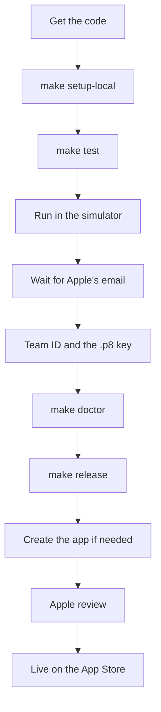
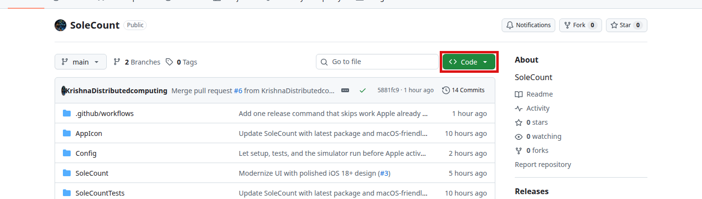
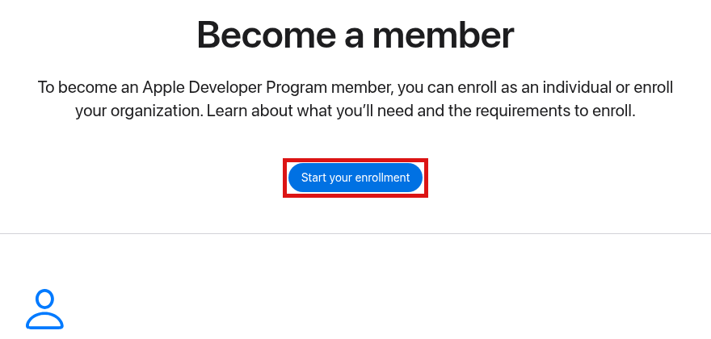
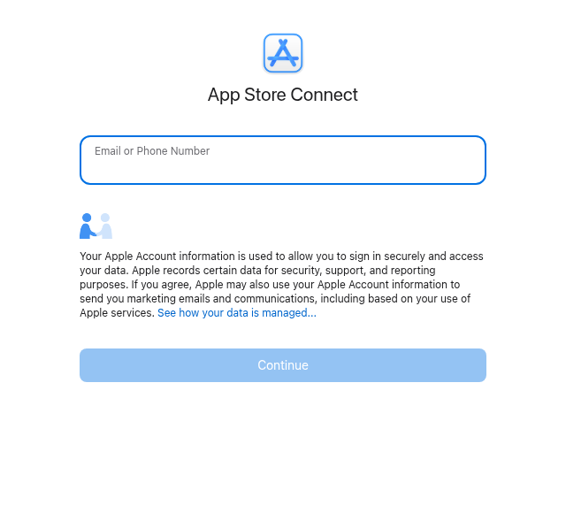
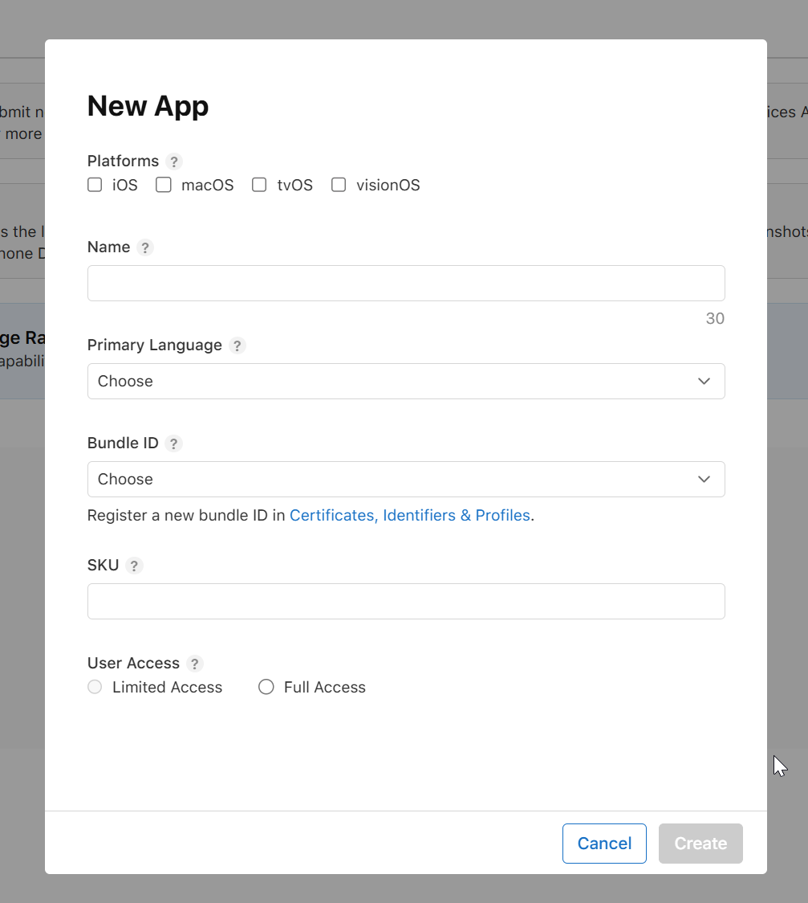
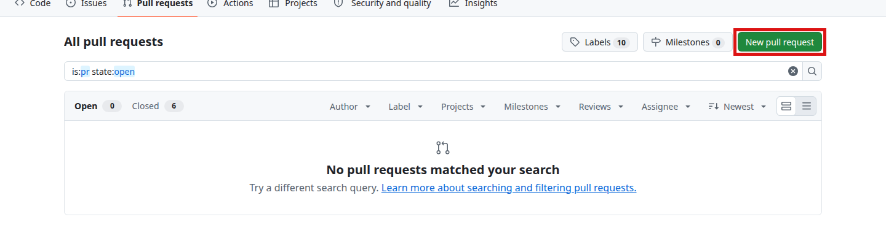
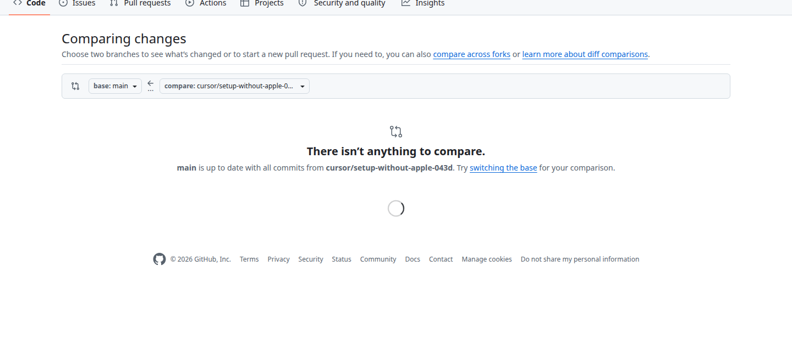

# Start here

This is the only setup page. Read it from the top and do the steps in order. You do not need the other guides.

You are new to the Mac. Apple may still be processing the paid Developer membership (up to 48 hours). You can build and run SoleCount today. You send it to Apple after the welcome email.

SoleCount is a free iPhone app. It counts how often you wear each pair, shows the cost per wear, and can read Apple Health steps so you can see kilometres per shoe. You can set a distance target, retire a pair without deleting it, keep a wishlist, and share a card made on the phone. The phone keeps all of the data. There is no account and no in-app purchase. The bundle ID is `com.krishnav.SoleCount`.

Do every command on the Mac. Copy a grey box, click Terminal, press Cmd + V, then press Return.



## Checklist

- [ ] 1. Open Terminal
- [ ] 2. Get the code
- [ ] 3. Set up the Mac with `make setup-local`
- [ ] 4. Run `make test`
- [ ] 5. Run the app in the simulator
- [ ] 6. After Apple's email: agreement, Team ID, and the `.p8` key
- [ ] 7. Run `make doctor`
- [ ] 8. Run `make release`
- [ ] 9. Create the app if needed. The paid purchase is not needed, because the app is free
- [ ] 10. Wait for Apple's review
- [ ] 11. Get later updates
- [ ] 12. Optional: ship again from GitHub

<a id="step-1"></a>

## 1. Open Terminal

**What you do**

Open this page in Safari. Click the compass icon in the Dock (the row of icons at the bottom of the screen). Click the address bar, type `github.com/KrishnaDistributedcomputing/SoleCount`, and press Return.

Open Terminal. Hold the Cmd key (⌘, next to the space bar) and press the space bar. Type `Terminal` and press Return. A window with a blinking cursor opens.

Copy a command from a grey box on this page. Click inside Terminal, press Cmd + V, then press Return. When the blinking cursor comes back on a new line, the command is finished.

If the Mac asks for your password, type it and press Return. Nothing appears while you type. That is normal.

Press Cmd + Tab to switch between Safari and Terminal. In Finder, press Cmd + Shift + . to show folders whose names start with a dot. Press it again to hide them.

**Copy this**

There is no command in this step.

**What you should see**

A window named Terminal, with a blinking cursor.

📸 Screenshot needed: Spotlight with the word Terminal typed in.

📸 Screenshot needed: the Terminal window, with the blinking cursor.

📸 Screenshot needed: the Mac password prompt, with no characters showing as you type.

**Why**

You copy commands from this page on the same Mac. A Mac cannot paste text that was copied on a Windows PC. Return is what tells the Mac to run the command. The password check is macOS asking permission to install tools later. The characters stay hidden for security.

**If it goes wrong**

The longer list is in Troubleshooting at the end of this page. For this step: if Spotlight does not open, click the magnifying glass at the top-right of the screen and type `Terminal`.

<a id="step-2"></a>

## 2. Get the code

**What you do**

This is the SoleCount page on GitHub. The green **Code** button is marked. You will not click it. The Terminal command below downloads the same code.



If you do not already have a SoleCount folder, skip to the clone command. If you do, delete it first. Deleting the folder on your Mac does not delete GitHub, and it does not delete the app in App Store Connect. Removing that website record is a separate step, and Apple keeps the app name reserved, so you usually do not remove it.

**Copy this** to see if the folder is on the Desktop:

```bash
ls -d ~/Desktop/SoleCount
```

**What you should see**

Either the path, such as `/Users/you/Desktop/SoleCount`, which means the folder is there, or this line:

```text
ls: /Users/you/Desktop/SoleCount: No such file or directory
```

`No such file or directory` means there is nothing to delete. Go to the clone command.

**Why**

You need to know the folder is there before you delete anything.

**Copy this** if you want to look outside the Desktop too:

```bash
mdfind -name SoleCount -onlyin ~ | head
```

**What you should see**

A short list of paths, or nothing. Spotlight does the same search: press Cmd + Space and type `SoleCount`. Only delete a folder you recognize as this project.

**Why**

The project might not be on the Desktop.

**Copy this** if you want to keep the answers you already typed. Skip it if the folder does not exist.

```bash
cp ~/Desktop/SoleCount/fastlane/.env ~/solecount-env-backup
```

**What you should see**

The cursor comes back and prints nothing. That means the copy worked. If you see `No such file or directory`, there was no answers file to save.

**Why**

`fastlane/.env` holds the Team ID, Key ID, Issuer ID, and Apple ID. This copies it to your home folder. It does not copy the `.p8` key. That key lives outside the project.

Close Xcode before you delete. Click Xcode, then press Cmd + Q.

**Why**

Xcode keeps the folder open. A delete can fail while Xcode is using it.

**Copy this**

```bash
cd ~
```

**What you should see**

The cursor comes back. The prompt may now show `~`.

**Why**

`cd ~` moves you to your home folder. You cannot delete a folder you are currently inside.

**Copy this**

```bash
rm -rf ~/Desktop/SoleCount
```

**What you should see**

The cursor comes back and prints nothing.

**Why**

This deletes `~/Desktop/SoleCount` permanently. It does not go to the Trash, and there is no undo. Read the path before you press Return. It must be `~/Desktop/SoleCount` and nothing else. The `.p8` key is outside this folder, so this command does not delete it.

Finder does the same job: open the Desktop, drag the SoleCount folder to the Trash, click the Trash, and choose **Empty Trash**.

**Copy this**

```bash
ls -d ~/Desktop/SoleCount
```

**What you should see**

```text
ls: /Users/you/Desktop/SoleCount: No such file or directory
```

**Why**

That line means the folder is gone. If you still see the path, the delete did not happen.

Optional deeper clean. Skip any command you do not need.

**Copy this**

```bash
rm -rf ~/Library/Developer/Xcode/DerivedData/SoleCount-*
```

**Why**

This removes SoleCount's old Xcode build cache. Other apps' build files stay.

In the Simulator app, long-press the SoleCount icon and choose **Remove App**. Or, with a simulator already open:

**Copy this**

```bash
xcrun simctl uninstall booted com.krishnav.SoleCount
```

**What you should see**

No error. If no simulator is open, you may see an error about no booted device. That is fine. Open Simulator and use the long-press instead.

**Why**

This removes the app from the simulator that is running. Sneaker data in that simulator copy is deleted with the app.

On your iPhone: long-press the SoleCount icon, tap **Remove App**, then **Delete App**.

**Why**

This removes the installed app from your phone. It does not remove an App Store listing.

Only if you also want to delete the App Store key, and you understand you cannot download that same file again:

**Copy this**

```bash
rm -f ~/.appstoreconnect/private_keys/AuthKey_*.p8
```

**Why**

Apple lets you download each `.p8` file only once. If you delete it and you have no other copy, you must revoke that key on the App Store Connect website and create a new one. Leave the file alone unless you are sure.

Homebrew, XcodeGen, and fastlane can stay. The next setup reuses them.

**Copy this** to download a fresh copy:

```bash
cd ~/Desktop && git clone https://github.com/KrishnaDistributedcomputing/SoleCount.git && cd SoleCount
```

**What you should see**

Lines that start with `Cloning into 'SoleCount'...`, then a cursor inside that folder. The first time you use `git`, a window may say **Install command line developer tools**. Click **Install**, wait, then run the command again.

**Why**

This downloads SoleCount onto the Desktop and moves into that folder. Later commands only work inside it. Those extra tools include `git`. The Mac does not include them until you install them.

If you saved the answers file, put it back after the clone:

**Copy this**

```bash
cp ~/solecount-env-backup ~/Desktop/SoleCount/fastlane/.env
```

**Why**

This restores the answers. The file stays on this Mac. Git does not upload it.

**If it goes wrong**

`fatal: destination path 'SoleCount' already exists` means the folder is still there. Run the delete commands above, then the clone again. More cases are in Troubleshooting at the end of this page.

<a id="step-3"></a>

## 3. Set up the Mac

**What you do**

Stay in the SoleCount folder. This installs the tools, creates the Xcode project, and opens Xcode. It does not need the paid membership.

**Copy this**

```bash
make setup-local
```

**What you should see**

The words below. Version numbers can differ. A `✔` line is a step that finished.

```text
==> Checking Xcode
✔ Xcode is ready

==> Checking Homebrew
✔ Homebrew ...

==> Installing XcodeGen and fastlane
✔ xcodegen ..., fastlane installed

==> Apple Developer questions
Skipping every Apple question.
That is fine while Apple is still processing your membership (up to 48 hours).

==> Generating SoleCount.xcodeproj
✔ Project generated

==> Done!
```

Then a list of skipped Apple items, and:

```text
You do not need them to run SoleCount in the iPhone Simulator.

Do this now:
  make test     run the tests in the simulator
  In Xcode, press Cmd + R to run the app

Your Apple Developer membership isn't active yet.
After Apple emails you, leave the .p8 file in Downloads and run: make release
```

Xcode opens at the end.

If Homebrew is installed during this command, it may ask for your Mac password. The script prints `Installing Homebrew (it may ask for your Mac password)...` Type the password and press Return. Nothing shows while you type.

**Why**

`make setup-local` runs `scripts/setup_mac.sh --no-apple`. In order, it:

1. Checks Xcode 26. Apple rejects uploads built with an older Xcode.
2. Installs Homebrew if it is missing. Homebrew installs the other tools.
3. Installs XcodeGen. It builds `SoleCount.xcodeproj` from `project.yml`. That project file is not stored on GitHub.
4. Installs fastlane with Homebrew. Later commands use it. This script does not run `bundle install`.
5. Creates `fastlane/.env`, a private file. Git ignores it.
6. Skips the Apple questions, because the Team ID and the key do not exist yet.
7. Leaves the Team ID blank in `Config/Team.xcconfig`. The simulator does not need one.
8. Builds `SoleCount.xcodeproj`.
9. Downloads the iPhone Simulator if none is installed, then opens Xcode.

**If it goes wrong**

`Xcode is not ready. Install Xcode 26 from the Mac App Store, open it once, then run this again.` Install Xcode 26, open it once, and run the command again. `Apple requires Xcode 26 or newer for uploads. Please update Xcode.` means the same thing. More cases are in Troubleshooting at the end of this page.

<a id="step-4"></a>

## 4. Run the tests

**What you do**

Stay in the SoleCount folder.

**Copy this**

```bash
make test
```

**What you should see**

The first line is exactly:

```text
Running tests in the iPhone Simulator. No Apple Team ID is needed.
```

Then the iPhone 17 Pro Max simulator opens and the tests run. A passing run ends with the tests passed. It can take about 10 minutes. The screenshot test is skipped here. No Team ID is required.

**Why**

This runs SoleCount's unit tests and UI tests before Apple's reviewers ever see the app.

**If it goes wrong**

`Unable to find a destination` means the simulator is not installed. Open Xcode, then Settings, then Components, and install the iOS Simulator. Then run `make test` again. More cases are in Troubleshooting at the end of this page.

<a id="step-5"></a>

## 5. Run the app in the simulator

**What you do**

Open the project, then run it.

**Copy this**

```bash
make open
```

**What you should see**

Xcode comes to the front with the SoleCount project.

**Why**

This rebuilds `SoleCount.xcodeproj` from `project.yml` and opens it.

In Xcode, press Cmd + R.

**What you should see**

The simulator shows SoleCount. You can add a pair and tap **Wore today**.

**Why**

Cmd + R builds the app and shows it on a pretend iPhone. The app is free, so there is no purchase to try.

**What you do** to try Apple Health sample data, still in this step:

1. In the simulator, open the Health app.
2. Tap Browse, then Activity, then Steps, then Add Data. Add a few thousand steps for today. If you see Walking + Running Distance, add a distance too.
3. Open SoleCount, add a pair or open Daily Runners if you used the sample shoes, and tap **Wore Today**.
4. Tap **Connect Apple Health**, allow the read, then tap **Refresh**.

**What you should see**

The pair shows kilometres (or miles, if the pretend iPhone is set to miles) and a step count. Today shows a step ring. If you say no to Health, wears and cost per wear still work.

**Why**

SoleCount only reads steps and walking distance for the days you marked a pair as worn. It does not write to Health, and it does not send the numbers anywhere. App Privacy stays Data Not Collected because nothing is transmitted.

When you add a pair, type a brand or tap one from the list (Nike, Adidas, and about 30 others). Pick a type such as Running. Running shoes start with a 600 km replacement target. You can change it or turn it off.

📸 Screenshot needed: Xcode with the SoleCount project open.

📸 Screenshot needed: the iPhone Simulator showing SoleCount after Cmd + R.

📸 SoleCount's own App Store pictures are not in this repo yet. They are taken from the real app, with sample shoes, by the screenshot test. On GitHub, open **Actions**, click **Screenshots**, then **Run workflow**. Download the artifact named `solecount-screenshots` when it finishes. Those files are not shown on this page until someone saves them into `docs/images/`.

Optional: put SoleCount on your own iPhone with a free Apple ID. In Xcode, open Settings, then Accounts, and add your Apple ID. Click the SoleCount project, open Signing & Capabilities, and choose your Personal Team.

**Why**

A free Apple ID can install SoleCount on your own phone. That install expires after 7 days. It cannot use the real purchase sandbox, and it cannot upload to TestFlight.

📸 Screenshot needed: Xcode Settings, Accounts, with an Apple ID added.

📸 Screenshot needed: Signing & Capabilities, with Personal Team chosen.

**If it goes wrong**

If Cmd + R says the simulator is missing, install it from Xcode Settings, then Components. More cases are in Troubleshooting at the end of this page.

<a id="step-6"></a>

## 6. After Apple's email

**What you do**

Stop after step 5 until Apple emails you that the paid membership is active. These items stay manual because Apple does not let a script do them:

- Paying, and waiting for the welcome email. You still need the paid Developer membership (the program that lets you upload). That is separate from the Paid Apps agreement.
- There is no purchase to set up. The app is free.
- Creating the API key and downloading the `.p8` file once.
- Typing the Team ID and the Issuer ID once. The Key ID is read from the file name. The Issuer ID is not.
- A 2FA code, if you want the script to create the app record.
- HealthKit on the App ID, only if `make doctor` prints a red line. The Fix line says the clicks. `make release` tries to turn it on for you.

If you have not enrolled yet, this is Apple's public enrollment page. The button to click is **Start your enrollment**. If you already paid, do not enroll again. Wait for the email.



After the email, sign in to App Store Connect. This is the public sign-in page. Type the email, then click **Continue**.



Then do these clicks once:

1. You can skip **Business** (older accounts say **Agreements, Tax, and Banking**). The app is free, so there is no purchase to set up.
2. Open [developer.apple.com/account](https://developer.apple.com/account), then **Membership details**. Copy the 10-character Team ID.
3. Back in App Store Connect, open **Users and Access**, then **Integrations**, then **App Store Connect API**, then **Team Keys**. If you see **Request Access**, click it and accept the terms.
4. Click **+** (**Generate API Key**). Name it `SoleCount`. Access: **Admin**. Click **Generate**.
5. Copy the Key ID (10 characters, in the list) and the Issuer ID (the long code above the table).
6. Click **Download API Key**. Apple lets you download this file only once. Leave it in **Downloads**. Do not put it inside the SoleCount folder. Do not edit the inside. The name must end in `.p8`, not `.p8.txt`.

There is no purchase page to fill in. The app is free.

📸 Screenshot needed: Membership details, with the 10-character Team ID visible.

📸 Screenshot needed: Team Keys, with the + button, the Key ID, and the Issuer ID.

📸 Screenshot needed: the Downloads folder showing a file named AuthKey_ and ending in .p8.

**Copy this**

```bash
ls ~/Downloads/AuthKey_*.p8
```

**What you should see**

A path like `/Users/you/Downloads/AuthKey_AB12CD34EF.p8`. The middle of that name is the Key ID.

**Why**

`make release` finds that file, reads the Key ID from the name, and copies it to `~/.appstoreconnect/private_keys/`. That folder is outside the project, so the key is never uploaded to the public GitHub. The key must be **Admin** because the upload uses Apple's cloud signing. App Manager is not enough for that signing step.

**If it goes wrong**

If `ls` prints `No such file or directory`, the download is not in Downloads. Press Cmd + Space and type `AuthKey`. If the only download was lost, revoke that key on the Team Keys page and create a new one. More cases are in Troubleshooting at the end of this page.

<a id="step-7"></a>

## 7. Check the Mac

**What you do**

Stay in the SoleCount folder. This does not upload anything.

**Copy this**

```bash
make doctor
```

**What you should see**

A checklist. Green `✔` lines are ready. Red `✖` lines include a `Fix:` command. Yellow `!` lines are notes. A passing run ends with:

```text
All required checks passed. Next: make release
```

It also prints this reminder, which is normal even when the checks pass:

```text
Still manual, because Apple does not allow a script to do them:
  - Pay for the Developer membership and wait for the welcome email
  - The app is free, so there is no purchase to create
  - Create the API key and download the .p8 file once
  - Type a 2FA code if you saved an Apple ID
  - If HealthKit is off, tick it: developer.apple.com > Certificates, Identifiers & Profiles > Identifiers > com.krishnav.SoleCount > HealthKit > Save
  - Widget App Group group.com.krishnav.SoleCount on com.krishnav.SoleCount and com.krishnav.SoleCount.widget, same Identifiers page, App Groups
  - Wait for Apple's review (about 1 to 2 days, sometimes longer)
```

`make doctor` does not ask questions. If the `.p8` file is still only in Downloads, a red line says the key file is missing and the fix is `make release`. That command finds the file, then runs these checks again.

**Why**

Doctor checks Xcode 26, the command line tools, Homebrew, XcodeGen, fastlane, Ruby, the git branch, `fastlane/.env`, the Team ID, the Key ID, the Issuer ID, that the `.p8` file is readable, the App Review phone and email, and one real call to App Store Connect.

**If it goes wrong**

Do the `Fix:` command on each red line, then run `make doctor` again. Do not start `make release` while a required line is red. More cases are in Troubleshooting at the end of this page.

<a id="step-8"></a>

## 8. Release

**What you do**

Run this once `make doctor` ends with `All required checks passed.` It is safe to run again. It skips records that already exist. It always uploads a new build, because Apple rejects a second upload of the same build number.

**Copy this**

```bash
make release
```

**What you should see**

First, if the `.p8` file is in Downloads:

```text
Found AuthKey_AB12CD34EF.p8.
The Key ID is the middle of that file name. Copying it outside the project so it is never committed.
```

The letters in the name will be your real Key ID.

Then Terminal asks only for answers that are still blank. Press Return only when you truly do not have that answer.

```text
Team ID (10 characters, developer.apple.com/account > Membership details) (press Return to skip):
Issuer ID (the long code above the keys table) (press Return to skip):
Apple ID email, optional, for the one-time app record and privacy answers (press Return to skip):
Phone number for App Review, with country code (press Return to skip):
Email for App Review (press Return to skip):
```

Then:

```text
Checks passed. Starting the release.
Finished steps are skipped. A new TestFlight build is uploaded, because Apple requires a new build number.
```

Then fastlane prints:

```text
Step 1 of 2: App Store records. Steps that are already done are skipped.
```

```text
Step 2 of 2: tests, a new build number, TestFlight, and the store listing. Review waits for make submit.
```

And later:

```text
Building SoleCount 1.0 (1)
```

The number in parentheses is the new build number. It is one higher than the latest TestFlight build. The first upload is build 1. Then:

```text
Build 1 is on TestFlight.
```

What this command does, in order:

1. Finds the `.p8` file and saves the Key ID from its name.
2. Registers the bundle ID `com.krishnav.SoleCount`, turns on HealthKit when Apple's API allows it, and registers `com.krishnav.SoleCount.widget` for the Home Screen widget.
3. Creates the app record if you typed an Apple ID. You get one 2FA code. If you pressed Return on the Apple ID question, it stops and tells you to use the website. That website form is the next step on this page.
4. Sets the price to free, the countries, and the age rating (4+).
5. Skips the in-app purchase. The app is free, so there is nothing to attach for review.
6. Takes the 6.9-inch App Store screenshots in the iPhone 17 Pro Max simulator if they are not saved yet. The test uses sample shoes, not your real pairs. Apple scales that size to the other iPhone sizes.
7. Runs the tests.
8. Builds, signs, and uploads to TestFlight.
9. Uploads the name, subtitle, description, keywords, promo text, support URL, privacy URL, Lifestyle category, and screenshots from `fastlane/metadata`.
10. Uploads the store listing and stops. It does not send the app to review. You should see `Uploaded to TestFlight. Not submitted for review. When you have tried the build, run: make submit`. Install that build from the TestFlight app on your iPhone. When it looks right, run `make submit`. That sends version 1.0 to App Review. There is no purchase to attach. After Apple approves it, the app goes live on its own.

If you typed an Apple ID, the privacy answers (SoleCount collects no data) are sent after the same 2FA code. If you did not, you will see:

```text
App Privacy: open App Store Connect > SoleCount > App Privacy > Get Started > 'No, we do not collect data from this app' > Save > Publish. (Or set APPLE_ID and rerun.)
```

A finished records step prints `App Store records are ready.`

**Why**

One command does every upload step Apple allows. Running it again does not create a second app. The paid purchase is not needed.

**If it goes wrong**

If you see `The App Store Connect app record doesn't exist yet`, do the next step on this page, then run `make release` again. If a red doctor line appears, do its `Fix:` line first. To stop after TestFlight and not submit:

```bash
bash scripts/deploy.sh --beta-only
```

That ends with `Stopped after TestFlight (--beta-only).` More cases are in Troubleshooting at the end of this page.

<a id="step-9"></a>

## 9. The website clicks Apple still requires

**What you do**

Do this step if `make release` stopped because the app record does not exist. The old "add the purchase for review" click is not needed. The app is free.

Apple's API key is not allowed to create the app. Either run `make release` again and type your Apple ID when asked (one 2FA code), or fill in this form. This picture is the real empty form.



1. Open [appstoreconnect.apple.com](https://appstoreconnect.apple.com). Click **Apps**, the blue **+**, then **New App**.
2. Platforms: **iOS** only.
3. Name: `SoleCount`. If Apple says that name is already being used, type `SoleCount: Sneaker Tracker`.
4. Primary Language: **English (U.S.)**.
5. Bundle ID: `com.krishnav.SoleCount`. If it is missing from the list, run `make release` once so it can register the ID, then refresh this page.
6. SKU: `solecount001`. If fastlane already created the app, it stored `solecount-ios` instead. Leave that one alone.
7. User Access: **Full Access**. Click **Create** when it turns blue.

**Copy this** after the app exists:

```bash
make release
```

**What you should see**

The same release text as the previous step. When the records exist, fastlane prints `App record: SoleCount...` and `App Store records are ready.`

**Why**

The installed app and the store listing must share `com.krishnav.SoleCount`. The SKU is a private ID only you see. You cannot change it later. The tools find the app by the bundle ID, not by the SKU.

The in-app purchase step is not needed. The app is free, so there is no SoleCount Pro product to add for review.

Also open **App Privacy** and publish **Data Not Collected**, unless the command already did that because you saved your Apple ID. SoleCount keeps every sneaker, and any Apple Health reading, on the phone. Nothing is transmitted, so "Data Not Collected" is the right answer. The privacy text is already in `PRIVACY.md` at the top of the project. You do not have to rewrite it.

📸 Screenshot needed: App Privacy, with Data Not Collected selected.

**What you should see**

`make release` submits the version itself. You should not see a message asking you to add a purchase.

**Why**

There is no purchase for Apple to review alongside the app. HealthKit still has to be on the App ID, or the uploaded build can be rejected. If `make doctor` is red about HealthKit, use the Fix line. It is the same clicks as: developer.apple.com, Certificates, Identifiers & Profiles, Identifiers, `com.krishnav.SoleCount`, tick HealthKit, Save.

**If it goes wrong**

If **Create** stays grey, a required field is empty. Check iOS, the name, English (U.S.), the bundle ID, the SKU, and Full Access. If the name is taken, use `SoleCount: Sneaker Tracker`. More cases are in Troubleshooting at the end of this page.

<a id="step-10"></a>

## 10. Wait for review

**What you do**

`make release` stops at TestFlight. Install the build from the TestFlight app on your iPhone and try it. When you want Apple to review it, run `make submit`. Then wait. Apple's review usually takes about 1 to 2 days. It can take longer. You cannot speed up the queue.

**Copy this** when the TestFlight build looks right

```bash
make submit
```

**Copy this** to check the status

```bash
make status
```

**What you should see**

Lines like these. The words change as Apple moves the build.

```text
API key works.
Bundle ID com.krishnav.SoleCount: registered.
App: SoleCount (id ...)
Version 1.0: WAITING FOR REVIEW
Latest TestFlight build: 1 (ready).
Next upload will use build 2.
HealthKit capability: on.
IAP: skipped (the app is free).
On the App Store: not yet.
```

`WAITING FOR REVIEW` or `IN REVIEW` means Apple has it. `READY FOR SALE` on the version, and `On the App Store: version 1.0 is live.`, means it is live. The app goes live by itself when Apple approves it. You do not press another button for that.

Before anything is uploaded, `make status` can instead say:

```text
TestFlight: no build yet. The next upload will be build 1.
On the App Store: not yet.
```

If the key is not on the Mac yet:

```text
Apple details are not on this Mac yet, so there is no review status.
You can still run the app: make test, then make open.
After Apple's email: make release
```

**Why**

This asks App Store Connect for the latest TestFlight build and the review state. It does not upload a new build.

**If it goes wrong**

A line that says the API key was rejected means the Key ID, the Issuer ID, and the `.p8` file do not match. Fix the key, then run `make doctor`. More cases are in Troubleshooting at the end of this page.

<a id="step-11"></a>

## 11. Get later updates

**What you do**

New work is saved on a branch first. `main` is the copy that `git clone` downloads. Merging copies the branch into `main`.

Open the Pull requests tab. The green **New pull request** button is marked.



Or open this address for the current branch:

[https://github.com/KrishnaDistributedcomputing/SoleCount/compare/main...cursor/setup-without-apple-043d](https://github.com/KrishnaDistributedcomputing/SoleCount/compare/main...cursor/setup-without-apple-043d)

This is that page as it looked when those commits were already in `main`. There is no **Create pull request** button, because there is nothing left to merge. For a later branch, change the name at the end of the address. When that branch is not in `main` yet, the same page shows a green **Create pull request** button. Click it, then **Create pull request** again. Wait for the checks. Click **Merge pull request**, then **Confirm merge**.



**Copy this** on the Mac, after the merge, from inside the SoleCount folder:

```bash
git checkout main && git pull
```

**What you should see**

Git switches to `main` and prints `Already up to date.` or a list of updated files.

**Why**

`git checkout main` switches this folder to the default copy. `git pull` downloads the newest saved version of that copy. If this folder is still on the branch and you only want that branch's latest commit, `git pull` alone downloads it. After the merge, switch back to `main` with the command above.

**If it goes wrong**

If the page says `There isn't anything to compare.`, the branch is already in `main`. Skip the merge and run the command above. More cases are in Troubleshooting at the end of this page.

<a id="step-12"></a>

## 12. Optional: ship again from GitHub

**What you do**

Skip this until SoleCount already exists in App Store Connect. GitHub cannot type your 2FA code, so it cannot create the app the first time.

On GitHub, open **Actions**, click **Release**, then **Run workflow**. That runs the same release lane as `make release`.

Add these repository secrets under **Settings**, **Secrets and variables**, **Actions**. Never put the `.p8` file in the repo.

| Secret | What to paste |
|---|---|
| `ASC_KEY_ID` | The 10-character Key ID |
| `ASC_ISSUER_ID` | The long Issuer ID |
| `ASC_KEY_P8` | The output of the command below |
| `TEAM_ID` | The 10-character Team ID |
| `REVIEW_PHONE` | Phone for App Review, with country code |
| `REVIEW_EMAIL` | Email for App Review |

**Copy this** on the Mac. It copies the encoded key. Paste that text into the `ASC_KEY_P8` secret. Do not paste it into the project.

```bash
base64 -i ~/.appstoreconnect/private_keys/AuthKey_XXXXXXXXXX.p8 | pbcopy
```

Replace `XXXXXXXXXX` with your real Key ID.

**What you should see**

The command prints nothing. The encoded text is on the clipboard.

**Why**

The GitHub computer does not have your Downloads folder. The secret is how it gets the same key for one run. The workflow writes it to a temporary file and deletes it. The phone and email stay in secrets too, so you do not commit them. The repo is public.

**If it goes wrong**

If the Action says a secret is missing, add that row from the table and run the workflow again. More cases are in Troubleshooting at the end of this page.

<a id="troubleshooting"></a>

## Troubleshooting

**Mac and Terminal**

- **The password field looks blank.** Type the password and press Return. macOS hides it on purpose.
- **A window says Install command line developer tools.** Click Install, wait, then run the `git` command again.

**Getting the code**

- **`not a git repository`.** You are not inside the SoleCount folder. Run `cd ~/Desktop/SoleCount`, then try again.
- **`git pull` says your local changes would be overwritten.** Run `git stash`, then `git pull`. `git stash` sets your Mac-only edits aside so the download can finish. Those edits stay in a side pile. You do not need them for normal setup.

**Setup**

- **Xcode is not ready.** Install Xcode 26 or newer from the App Store, open it once, then run `make setup-local` again.
- **You skipped a question by mistake.** Run `make release` again. Saved answers are kept. Blank ones are asked again.

**The .p8 file**

- **The name does not end in `.p8`.** Rename it. Do not edit the inside.
- **You cannot find it.** Run `ls ~/Downloads/AuthKey_*.p8` and `mdfind -name AuthKey_`.
- **You lost the only download.** Revoke that key and generate a new one.
- **Never commit it.** Keep it in `~/.appstoreconnect/private_keys/`.

**The New App form**

- **The name is already being used.** Type `SoleCount: Sneaker Tracker`.
- **The bundle ID is not in the list.** Run `make release`, then refresh. Or register `com.krishnav.SoleCount` under Certificates, Identifiers & Profiles, and tick HealthKit.
- **Create stays grey.** A field is empty.

**Upload**

- **`make doctor` has a red line.** Do the Fix command on that line, then run `make doctor` again.
- **`make release` cannot find the .p8 file.** Leave `AuthKey_*.p8` in Downloads. The name must end in `.p8`. Then run `make release` again.
- **The app record does not exist yet.** Type your Apple ID when asked, or fill in the New App form in step 9, then run `make release` again.
- **No valid code signing identity.** For the simulator you can ignore this. For an upload, the Team ID has to be the paid one. Run `make release` and type it.
- **HTTP 401.** The Key ID, Issuer ID, and `.p8` file do not match.
- **HTTP 403.** The key must be Admin, and the agreements must be accepted.

**Ask for help**

Copy the error in Terminal: drag across the red lines, then press Cmd + C.

If Claude Code is installed, go to the SoleCount folder and type `claude`. If not, paste this at [claude.ai](https://claude.ai) or into Cursor.

```text
I'm setting up the SoleCount iOS app on my Mac and I'm a beginner to macOS and Terminal. I ran this command:

[PASTE THE COMMAND YOU RAN HERE]

And I got this error:

[PASTE THE ERROR TEXT FROM TERMINAL HERE]

Can you explain what went wrong in simple terms and tell me exactly what command to run to fix it?
```

**Why**

The prompt gives Claude the command and the real error, so the answer matches SoleCount's scripts.

<a id="commands"></a>

## Commands

| Command | What it does | When to use it |
|---|---|---|
| `make setup-local` | Installs tools, builds the project, opens Xcode. Skips Apple questions. | Before the membership is active. |
| `make setup` | Same as setup-local when the Team ID, key, and Issuer ID are missing. If a `.p8` file is already on the Mac, it saves that key. | First setup, or any time. |
| `make test` | Runs tests in the iPhone Simulator. No Team ID. | After setup. |
| `make open` | Rebuilds the project and opens Xcode. Then press Cmd + R. | When you want to see the app. |
| `make doctor` | Green and red checklist, including one real API call. | After Apple's email, before you release. |
| `make release` | Finds the `.p8` file, then creates the records, tests, uploads a new build, and submits. Skips finished records. | The command to ship. Safe to run again. |
| `make deploy` | Same as `make release`. | Same as `make release`. |
| `make status` | Shows the TestFlight build and the review state. | While you wait for Apple. |
| `make appstore-setup` | Only the App Store records. No upload. | When you want the records without a new build. |
| `bash scripts/deploy.sh --beta-only` | Uploads to TestFlight and stops before review. | When you do not want review yet. |
| `make clean` | Deletes build files and the generated Xcode project. | When you want a fresh project. Then run `make open`. |
| `git checkout main && git pull` | Switches to `main` and downloads it. | After a branch is merged. |
