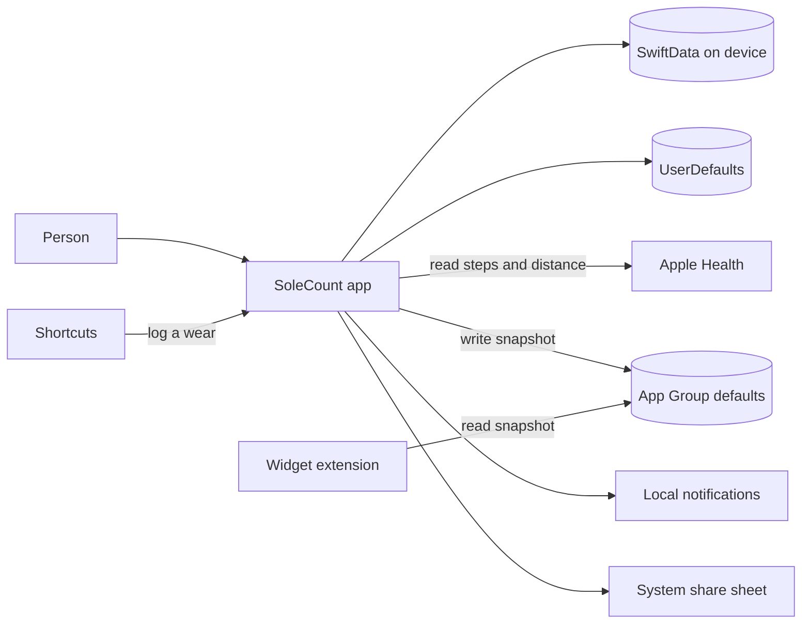
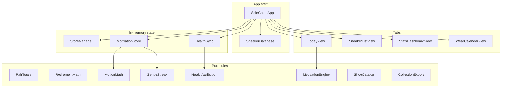
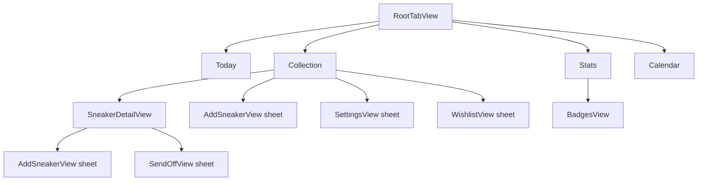
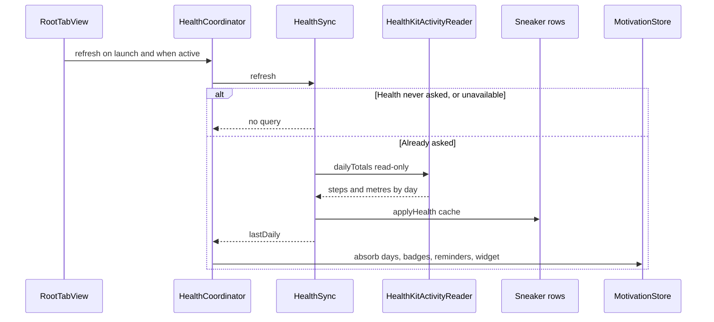
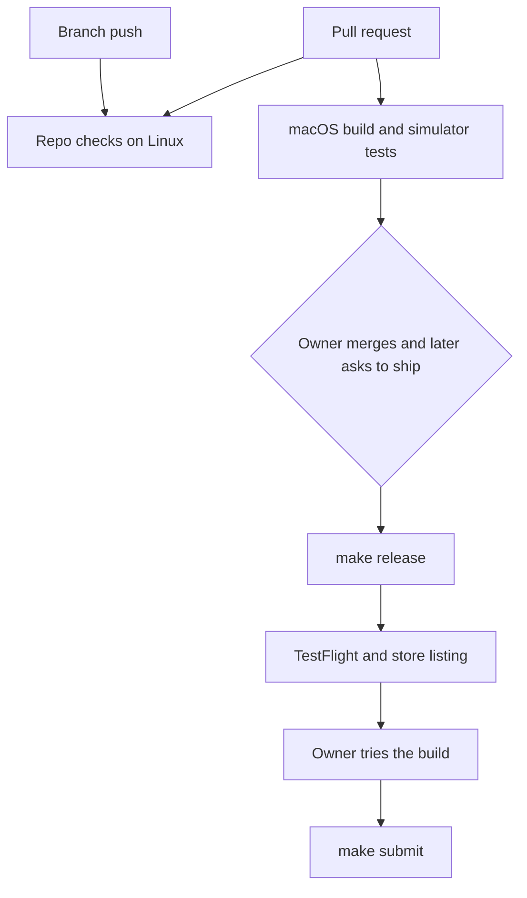

# SoleCount technical design

This page describes the app as it exists in this GitHub tree. It is the design record for later pull requests. Setup steps stay in [START-HERE.md](START-HERE.md). Day-to-day work stays in [DEVELOPER.md](DEVELOPER.md). The next upload stays in [RELEASE-CHECKLIST.md](RELEASE-CHECKLIST.md).

A few words used below:

- A **bundle ID** is the app's permanent name on Apple's systems. SoleCount's is `com.krishnav.SoleCount`.
- **SwiftData** is Apple's on-device database for Swift. A **model** is one kind of saved object, such as a sneaker.
- **SwiftUI** is the screen toolkit. **@Query** loads saved objects into a screen. **@Observable** is the newer way to share in-memory state.
- A **lane** is one fastlane command, such as test or ship.
- **TestFlight** is Apple's tester install. **App Review** is the separate step that can put the app on the store.

## Status of this document

| | |
|---|---|
| Written | 7 November 2026 |
| Branch | `cursor/ai-adlc-foundation-a2e5` |
| App-code baseline | GitHub `main` commit `d41209a` (4 November 2026) |
| Extra code on this branch | `SoleCountTests/IdentityTests.swift` only. Docs, templates, and CI text around it do not change the app. |
| Marketing version in `project.yml` | `1.0` |
| Committed build number | `1` |

Three labels are used on purpose:

- **Implemented.** The file and behavior are in this GitHub tree. Paths below were read for this page.
- **Proposed.** A later change. It is not in the code.
- **Unknown (Mac copy).** Work reported on `~/Desktop/SoleCount` that is not on GitHub. This page does not describe that code, because it was not inspected.

## Baseline the shipped app may not match

The owner reported that App Store version 1.0 build 2 was approved on 6 November 2026, and that the Mac folder holds commits and uncommitted files GitHub does not have. This environment did not open that Mac and did not sign in to App Store Connect. The approved binary was not compared with `d41209a`.

Commits named as Mac-only, and absent from this clone: `740a4a8`, `d99297c`, `90a5e9f`, `e2a3f71`, `2a028c2`, `afd2f8e`, `66a2717`, `bb63397`. Uncommitted Mac work was also reported around signing, the widget, the Fastfile, screenshots, and contact setup. No file contents from that work are known here.

What that means for this design:

- If those commits add screens, fields, or permissions, this page under-describes the binary Apple approved.
- `docs/PRIVACY.md` on GitHub mentions a camera and a "Sole check". `project.yml` has no camera purpose string, and no Swift file here implements a sole check. The root `PRIVACY.md` does not mention the camera. Which text matches the approved app is **Unknown (Mac copy)**.
- `project.yml` says build `1`. fastlane does not upload that number. At upload it asks App Store Connect for the latest TestFlight build and adds one. A later upload is a new build. It is not a rebuild of build 2.
- GitHub branch `cursor/setup-without-apple-043d` points at `8707a16`, which is already in `main` through pull request 7. A Mac branch can reuse that name and still differ.
- Open pull requests at the inspection: none. Nothing unreviewed was merged into this description.

Until the Mac folder is compared, treat this page as the design of **this GitHub tree**, not as a certificate of the approved binary. The comparison steps are in the release checklist. Do not delete that folder to "match GitHub".

## 1. Purpose, scope, and non-goals

### Purpose

**Implemented.** SoleCount is a free iPhone app that records which sneakers were worn, shows price divided by wears, and can read Apple Health steps and walking-plus-running distance so each pair shows distance. It is encouragement, not a medical device. That boundary is stated in the in-app Health copy and in `fastlane/metadata/review_information/notes.txt`.

### Product constraints

**Implemented** and checked by `scripts/check_repo.sh`:

- The app stays free. `SoleCount/FeatureFlags.swift` sets `monetizationEnabled` to `false`. While that is false, every feature is available and the pair cap is not applied (`StoreManager.hasFullAccess`, `StoreManager.canAddPair`).
- Data stays on the iPhone. The SwiftData store sets `cloudKitDatabase: .none` (`SoleCount/SneakerDatabase.swift`). There is no account and no SoleCount server.
- Health is optional and read-only. The app still runs when Health is missing or refused.
- The bundle ID stays `com.krishnav.SoleCount`. The widget ID stays `com.krishnav.SoleCount.widget`. The unused product ID stays `com.krishnav.SoleCount.pro`.
- Public URLs stay the GitHub privacy page, the GitHub support page, and the repository marketing URL. See section 11.

### In scope for this tree

The iPhone app, a Home Screen widget extension, a Shortcuts intent inside the app target, unit tests, UI tests, XcodeGen `project.yml`, fastlane, and GitHub Actions.

### Non-goals

**Implemented as absence.** No user accounts, analytics, ads, third-party Swift packages, or `Package.swift`. No writing to Apple Health. No CSV import. No iCloud backup of the database. No iPad, Mac, or visionOS layout (`project.yml` sets iPhone-only and turns those destinations off). StoreKit code remains in the project and does not run while the free flag is false.

**Out of scope for the change that added this page:** app behavior, assets, signing, TestFlight, and App Review.

## 2. System shape



**Implemented.** The widget does not call HealthKit. `Shared/WidgetSnapshot.swift` says the app writes the snapshot and the widget only reads it. Shortcuts call `LogTodayWearIntent` in the app target, which opens the app (`openAppWhenRun = true`) and writes the same SwiftData store.

Apple's servers appear in the release tools (fastlane, App Store Connect API), not in the running app, except StoreKit, which the free-flag path does not start. See section 14.

## 3. Component architecture



`SoleCountApp` creates one `ModelContainer` and three observable objects, then injects them with `.environment` (`SoleCount/SoleCountApp.swift`). Screens read sneakers with `@Query`. They do not each open a database.

Pure rules take numbers and dates and return numbers. They do not import HealthKit. That split is why unit tests can run the math without a Health permission prompt.

## 4. Directory map

| Path | Responsibility |
|---|---|
| `SoleCount/` | App target. Screens, models, math, Health, reminders, Shortcuts. |
| `SoleCount/SoleCountApp.swift` | `@main` entry. |
| `SoleCount/RootTabView.swift` | Four tabs. Refreshes Health when the app becomes active. |
| `SoleCount/Sneaker.swift` | Pair model and wear/health cache. |
| `SoleCount/SneakerPhotoItem.swift` | Extra photos. |
| `SoleCount/WishlistItem.swift` | Not-yet-bought pairs. |
| `SoleCount/SneakerDatabase.swift` | One container, CloudKit off. |
| `SoleCount/FeatureFlags.swift` | Free-app switch. Fastlane reads the false line. |
| `SoleCount/StoreManager.swift` | StoreKit 2, idle while the flag is false. |
| `SoleCount/HealthKitActivityReader.swift` | The only HealthKit queries. |
| `SoleCount/HealthSync.swift` | When to ask, and writing the cache onto pairs. |
| `SoleCount/HealthCoordinator.swift` | Refresh, badges, reminders. |
| `SoleCount/MotivationStore.swift` | Goals, cached days, gentle streak, widget publish. |
| `Shared/WidgetSnapshot.swift` | Codable snapshot and App Group key. Compiled into the app and the widget. |
| `SoleCountWidget/` | WidgetKit extension. Small family only. |
| `SoleCountTests/` | Swift Testing unit tests. |
| `SoleCountUITests/` | XCTest UI tests and screenshot tests. |
| `project.yml` | XcodeGen source of truth. The `.xcodeproj` is not committed. |
| `Config/Team.xcconfig` | `DEVELOPMENT_TEAM` left blank in git. |
| `fastlane/` | Test, screenshot, TestFlight, and metadata lanes. |
| `scripts/` | Mac setup, doctor, release, submit, and `check_repo.sh`. |
| `.github/workflows/` | Linux repo checks, macOS test, manual release, manual screenshots. |
| `docs/` | Human guides. This file lives here. |

`project.yml` lists each target's sources. The app and the widget both compile `Shared/`. The widget does not compile the SwiftData models.

## 5. Navigation and state



**Implemented.**

- Tabs are Today, Collection, Stats, and Calendar (`SoleCount/RootTabView.swift`). There is no fifth tab.
- Collection uses `NavigationStack` and `navigationDestination(for: Sneaker.self)` to the detail screen (`SoleCount/SneakerListView.swift`).
- Add, edit, settings, wishlist, paywall, and the retirement send-off are sheets.
- Detail's toolbar menu edits the pair, retires it, or brings it back (`SoleCount/SneakerDetailView.swift`). The list section for retired pairs is titled "Retired". The detail label and the send-off button say "Hall of Fame".
- Settings is a sheet from Collection, not its own tab (`SoleCount/SettingsView.swift`).

State ownership:

| Object | Lifetime | Holds |
|---|---|---|
| `ModelContainer` | App process, reused for the on-disk store | Sneakers, photos, wishlist |
| `StoreManager` | App `@State` | Pro flag and StoreKit, unused while free |
| `HealthSync` | App `@State` | Health access state and the last daily map |
| `MotivationStore` | App `@State` | Goals, day cache, streak, reminder switches |
| View `@State` | One screen | Sheets, filters, form fields |

`LaunchFlags` (`SoleCount/LaunchFlags.swift`) reads process arguments only in DEBUG. In Release every flag is false. UI tests pass `-UITesting` and `-HealthUnavailable`. Screenshot runs can pass `-DemoData`. Those flags must not change the App Store binary.

## 6. SwiftData

### Entities

**Implemented.** Three models, registered together in `SneakerDatabase.makeContainer`:

`Sneaker` (`SoleCount/Sneaker.swift`). Defaults are on the properties so older rows can open. There is no `VersionedSchema` and no custom migration stage in this tree. A future field still needs a default, or SwiftData may fail to open the store. The open failure path is `fatalError` in `SneakerDatabase`.

| Property | Default | Role |
|---|---|---|
| `name`, `brand`, `notes`, `size`, `colorway` | `""` | Text the person typed |
| `price` | `0` | Money paid |
| `purchaseDate`, `createdAt` | `Date.now` | Purchase day, and when the row was created |
| `photoData` | `nil` | Original photo. `@Attribute(.externalStorage)` |
| `wearDates` | `[]` | One date per "Wore today" tap. Not de-duplicated by the model |
| `isRetired` | `false` | Hall of Fame flag. The row stays |
| `wearLimit` | `nil` | Optional wear-count goal |
| `shoeTypeRaw` | `Other` | `ShoeType` raw value |
| `conditionRaw` | `Good` | `ShoeCondition` raw value |
| `cachedSteps`, `cachedDistanceMeters` | `0` | Last Health split |
| `cachedMonthlyMetersCSV` | `""` | Six month buckets, oldest first, comma-separated metres |
| `cachedSharedDays` | `0` | Days split with other pairs |
| `cachedShareOthers` | `0` | `0` none, `-1` mixed, else the other-pair count |
| `healthUpdatedAt` | `nil` | When the cache was written |
| `replaceAtKilometers` | `0` | `0` means no distance target |
| `startingWears`, `startingKilometers` | `0` | Totals from before SoleCount |
| `retirementAlertMark` | `0` | `0`, `80`, or `100` |
| `retirementAlertBaselined` | `false` | First pass records the mark and does not notify |
| `photos` | `[]` | Relationship below |

`SneakerPhotoItem` (`SoleCount/SneakerPhotoItem.swift`): `createdAt`, external-storage `photoData`, and an optional `sneaker` back-link. The comment says the original `photoData` field remains so older pairs still open.

`WishlistItem` (`SoleCount/WishlistItem.swift`): `brand`, `modelName`, `targetPrice` (default 0), `notes`, external-storage `photoData`, `createdAt`. It is not a `Sneaker` until "I bought it" copies fields through `WishlistMath.bought`.

`ShoeType` and `ShoeCondition` live in `SoleCount/ShoeCatalog.swift`. Types with a default replace distance: running and training 650 km, trail 650 km, walking 800 km, basketball 500 km. Every other type starts with the target off (`nil`).

### Relationship and deletion

**Implemented.**

```text
Sneaker 1 --- * SneakerPhotoItem
delete rule: cascade
inverse: SneakerPhotoItem.sneaker
```

Replacing photos deletes the old `SneakerPhotoItem` rows, inserts the new ones, and also writes `photoData` to the first image (`Sneaker.replacePhotos`).

Wishlist rows are deleted with `modelContext.delete` (`SoleCount/WishlistView.swift`).

No screen in this tree deletes a `Sneaker`. Retire sets `isRetired`. "Bring back" clears it. Send-off copy says the history stays. A cascade delete of photos would run only if some future code deletes the sneaker.

There is no unique constraint on the name. Two pairs can share a name. The Shortcuts matcher prefers an exact active name, then a contains match (`SoleCount/LogTodayWearIntent.swift`).

### Store configuration

**Implemented.** `ModelConfiguration(isStoredInMemoryOnly:cloudKitDatabase: .none)`. Disk containers are cached in a static `disk` so the Shortcuts intent and the app share one container. UI tests and demo launches pass `inMemory: true` because `LaunchFlags.uiTesting` or `LaunchFlags.demoData` is set. Demo rows are inserted only in DEBUG.

CloudKit sync is off. There is no export of the SwiftData file to iCloud in this code. Uninstalling the app removes the store with the app sandbox. That is stated in `PRIVACY.md`. There is no in-app backup or restore.

## 7. Calculations and units

Stored distance is metres. Replacement goals and the weekly goal are kilometres. Display uses `DistanceFormat`: kilometres, or miles when the locale is not metric. Screenshot launches force kilometres (`LaunchFlags.screenshots`). One mile is `1609.344` metres.

| Rule | Where | Edge case |
|---|---|---|
| Wears = logged taps + starting wears, each side at least 0 | `PairTotals.wears` | A negative starting value does not subtract |
| Metres = tracked metres + starting kilometres × 1000, each side at least 0 | `PairTotals.meters` | |
| Cost per wear = price / wears | `PairTotals.costPerWear` | `nil` when wears is 0. Price 0 stays 0 |
| Same-day purchase counts as 0 days owned | `PairTotals.daysOwned` | |
| Life fraction = metres / (goal km × 1000) | `RetirementMath.fraction` | `nil` when the goal is 0. Negative metres become 0 |
| Band | `RetirementMath.band` | Green under 80%, yellow from 80% until the goal, red at or past the goal |
| Alert marks | `RetirementMath.marks` | Only the 80% and 100% crossings. Empty when the goal is off |
| "Reached" | `Sneaker.reachedMileageGoal` | Goal > 0 and metres + 0.5 ≥ goal km × 1000 |
| Average metres per wear | `Sneaker.averageMetersPerWear` | `nil` when wear count is 0 |
| Collection average cost | `CollectionMath.summarize` | Sum of prices of pairs with at least one wear, divided by all wears. `nil` when total wears is 0. Most-worn and least-worn look at active pairs only |
| Forgotten pairs | `CollectionMath.forgotten` | Active pairs never worn, or last worn at least 30 days ago. Retired pairs are skipped. Never-worn sorts first |
| Health split | `HealthAttribution.attribute` | A day's steps and metres are divided evenly by the number of pairs worn that day. Days outside the latest six calendar months stay in the totals and out of `monthlyMeters` |
| Share note | `HealthAttribution.shareNote` | `nil` when the pair had every day to itself. Mixed other-pair counts become "shared with other pairs on some days" |
| Step streak used by some badges | `MotionMath.streak` | Counts back from today, or from yesterday if today is not a hit yet |
| Gentle streak | `GentleStreak` | One banked rest day per 6 hit days, cap 2. A miss spends a banked day or resets. Pause freezes the number. Changing the step goal does not replay old days |
| Walk suggestion | `MotionMath.walkPlan` | Brisk pace is 115 steps per minute. Suggestion is 5 to 30 minutes. Health off uses a 10-minute plan and does not claim the goal is done |
| Weekly trend | `MotionMath.trend` | Flat when the two weeks differ by less than 1 metre |
| Badges | `MotivationEngine.badges` | Thresholds are kilometres of collection distance (10, 50, 100, 500), a 42.195 km week, streaks of 7 and 30, a 10,000-step day, full rotation, a pair at its target, wear counts 1, 50, and 100, cost per wear under 1, and 10 pairs |
| Step goal clamp | `MotivationStore.setStepGoal` | 1,000 through 100,000. Missing stored goal defaults to 8,000. Weekly kilometres default to 20 |
| Money display | `Double.asCurrency` | The phone's currency, or USD if the locale has none |
| CSV distance | `CollectionExport` | Header says `Distance km`. Values are metres / 1000, two decimal places, POSIX locale. Dates are `yyyy-MM-dd` |

Logging a wear appends a `Date`. It does not reject a second tap on the same day at the model layer. `woreToday` is true if any stored date is today, and undo removes only the last today entry (`Sneaker.undoTodayWear`).

Health attribution builds a fresh `UUID` per pair per refresh and throws it away after matching results. It is not the SwiftData persistent ID.

## 8. User and data flows

### Add a pair and log a wear

**Implemented.** Collection, Add, form in `AddSneakerView`, save into SwiftData. "Wore today" on the detail screen calls `logWear`. Cost per wear updates from the wear count. The first-launch UI test covers add, catalog brand choice, and a wear (`SoleCountUITests/JourneyTests.swift`) with Health forced off.

### Health refresh

**Implemented.**



`HealthSync.refresh` does not show the system prompt. `connectAndRefresh` does, and only after the person asks to connect. The query starts at the older of 60 days ago and the earliest wear day, and ends at the start of tomorrow. Denied or failed reads set `access` to `.failed` with a sentence that wears and cost per wear are still on the phone. `UnavailableHealthReader` returns an empty map and does not prompt.

The reader requests `toShare: []` and reads `.stepCount` and `.distanceWalkingRunning` only (`SoleCount/HealthKitActivityReader.swift`).

### Retire

**Implemented.** Menu sets `isRetired` and presents `SendOffView`. Stats remain on the model. Retired pairs leave the active most-worn and forgotten lists and the Shortcuts matcher. They still count in collection totals. Bring-back clears the flag. The first Health pass sets `retirementAlertBaselined` and does not notify. Later crossings notify only when the retirement switch is on and notification permission is granted (`HealthCoordinator.retirementAlerts`).

### Wishlist

**Implemented.** A wishlist row stays off the collection until bought. `WishlistMath.bought` uses the model name, or the brand, or "New pair", and clamps a negative target price to 0. The test `buyingAWishFillsTheCollectionPair` covers that mapping (`SoleCountTests/RoundFeaturesTests.swift`).

### Export and share

**Implemented.** Settings builds a CSV through `CollectionExport.csv` and hands it to the share sheet as `CSVShare` (`SoleCount/CSVShare.swift`), a temporary file named `SoleCount.csv`. Fields that contain a comma, quote, or newline are quoted. There is no import.

Stats can render a PNG on device with `CardRenderer` (`SoleCount/ShareCards.swift`), 360×480 points at scale 2, and share it as `PNGShare`. The card forces the SoleCount title and the summary text. It is not uploaded by the app.

### Widget

**Implemented.** `MotivationStore.publishWidget` writes `WidgetSnapshot` (today's steps, step goal, gentle streak, `updatedAt`) into the App Group suite `group.com.krishnav.SoleCount`, key `widgetSnapshot`. The widget reloads that JSON on a 30-minute timeline (`SoleCountWidget/SoleCountWidget.swift`). Placeholder numbers are for the widget gallery only. If the suite is missing, save and load no-op or return nil, and the widget shows the empty snapshot (0 steps, goal 8,000, streak 0).

App Group entitlements are on the Release configuration only (`project.yml` sets `CODE_SIGN_ENTITLEMENTS` for Release, not Debug). A Debug simulator build can therefore run without the group. That is a known gap for widget checks in the unsigned test lane.

### Shortcuts

**Implemented.** One app shortcut, phrase "Log today's sneakers in SoleCount". Empty names and unknown names return a spoken sentence and do not crash. A match on an active pair appends today's wear and saves. Retired pairs are ignored. Failures of `fetch` or `save` are swallowed with `try?`; a failed fetch looks like "no pair".

## 9. Persistence lifecycle

| Data | Where | Leaves the phone? |
|---|---|---|
| Pairs, wears, wishlist | SwiftData store, CloudKit off | Only if the person shares a CSV or a card |
| Photos | External storage blobs, JPEG at most 1024 px, quality 0.8 (`ImageHelper.downsized`) | Same. The picker copy is the app's copy |
| Goals, streak, reminder switches, recent brands, Health-asked flag, seen badges | `UserDefaults.standard` | No |
| Widget snapshot | App Group `UserDefaults` in Release | No. The widget reads it on device |
| Day totals for Today | JSON in `UserDefaults` key `motionDays` | No |
| Pro flag | `UserDefaults` key `isPro` | Unused while the free flag is false |

`PrivacyInfo.xcprivacy` for the app and the widget declares no tracking and no collected data types. The required-reason API entry is UserDefaults `CA92.1` only.

There is no backup screen and no import. A person who deletes the app deletes this data. A CSV they already shared is outside the app.

## 10. Permissions, privacy, and security

**Implemented in this tree.**

| Permission | Evidence | When it is asked |
|---|---|---|
| Health read | `NSHealthShareUsageDescription` in `project.yml`. Share set is empty in `HealthKitActivityReader` | When the person connects Health. Not at launch |
| Notifications | `WearReminder.requestAccess` with alert and sound | When a reminder switch is turned on, not at launch |
| Photos | `PhotosPicker` in add and wishlist. No photo-library or camera purpose string in `project.yml` | The system picker. The app does not browse the library itself |

No `NSHealthUpdateUsageDescription`. No camera purpose string. The public page `docs/PRIVACY.md` still mentions a camera and a sole check. That mismatch is recorded in section "Baseline". Do not "fix" the public page until the approved binary is known.

In-app links (`SoleCount/SettingsView.swift`, `AppLinks`):

- Privacy: `https://github.com/KrishnaDistributedcomputing/SoleCount/blob/main/docs/PRIVACY.md`
- Support: `https://github.com/KrishnaDistributedcomputing/SoleCount/blob/main/docs/SUPPORT.md`
- Terms: Apple's standard EULA

The same privacy and support URLs are the App Store metadata files. `scripts/check_repo.sh` fails if they move.

Secrets boundary:

- `fastlane/.env`, `*.p8`, `AuthKey_*`, certificates, and profiles are gitignored.
- Review phone and email files in git stay `REPLACE_ME`. Real values belong in `fastlane/.env` or GitHub Actions secrets.
- `Config/Team.xcconfig` keeps `DEVELOPMENT_TEAM` blank. The Team ID is not a product secret, and it is still not committed.
- CI writes the API key to `$RUNNER_TEMP` and deletes `AuthKey_*.p8` at the end. Workflow permissions are `contents: read`. Checkout uses `persist-credentials: false`.
- This is not a full security review. Actions are not pinned to commit SHAs. That pin is **Proposed**.

StoreKit network calls exist in `StoreManager.loadProducts` and are not started when `monetizationEnabled` is false, because `init` returns first.

## 11. Widget and integration boundaries

| Integration | Process | Talks to |
|---|---|---|
| App | `com.krishnav.SoleCount` | SwiftData, HealthKit, UserNotifications, App Group in Release, StoreKit code |
| Widget | `com.krishnav.SoleCount.widget` | App Group snapshot only. WidgetKit, SwiftUI. Its privacy manifest mirrors the app's UserDefaults reason |
| Shortcuts | Inside the app process | SwiftData through `SneakerDatabase` |
| Share sheet | System UI | A CSV or PNG the person chooses to send |
| App Store Connect | Developer Mac or GitHub Actions | Not part of the installed app's daily use |

The widget family is `.systemSmall` only. Kind string is `SoleCountSteps`.

## 12. Errors, accessibility, performance

### Errors

**Implemented.**

- Database open failure stops the process with `fatalError`. There is no recovery screen.
- Health failures become short sentences and leave wears intact.
- Store errors set `showError` for an alert. That path is not entered while the app is free.
- Widget encode failure returns without throwing.
- Notification schedule failures use `try?`.
- Shortcuts return a sentence instead of throwing for a missing name.

### Accessibility

**Implemented, not a certified audit.** Several controls set `accessibilityLabel` or an identifier used by UI tests (add, save, wore today, retire, starting distance). Decorative art is `accessibilityHidden`. Rings and confetti read `accessibilityReduceMotion`. The widget step count uses `minimumScaleFactor` so a large number can shrink. There is no Dynamic Type snapshot test in this tree. Do not claim a finished VoiceOver pass.

### Performance

**Implemented choices, not measured budgets.**

- Health totals are cached on the sneaker so the list does not wait on HealthKit.
- Photos are external-storage JPEGs capped at 1024 px and quality 0.8.
- The Health query is bounded by recent days plus wear history, not the person's entire Health archive.
- The widget timeline is one entry, refreshed after 30 minutes, so it does not poll Health.
- Today's chart data is the `motionDays` cache, not a live Health query on every frame.

No Instruments numbers are in the repo. Treat performance claims beyond this list as **Proposed** until someone measures them.

## 13. Platforms and toolchain

**Implemented, from `project.yml` and the workflows.**

| Item | Value |
|---|---|
| Minimum iOS | 18.0 |
| Devices | iPhone only (`TARGETED_DEVICE_FAMILY` 1). Portrait only |
| Mac Catalyst, Designed for iPad, visionOS | Off |
| Swift | 5.0 |
| Xcode | 26 (`xcodeVersion`, and the CI step that selects `Xcode_26`) |
| UI language | English |
| Tests and screenshots | Simulator name from `SIM_DEVICE`, default `iPhone 17 Pro Max` |
| CI build | `runs-on: macos-26` |
| Cheap checks | `ubuntu-latest` via `make check` |

Linux can run `scripts/check_repo.sh`. It cannot compile SwiftUI or boot the simulator. A green Linux check is not a green iOS build.

Local unsigned test lane: `fastlane` `run_tests` passes `CODE_SIGNING_ALLOWED=NO` and skips `ScreenshotTests`. `scripts/compile_device.sh` compiles for generic iOS with signing off. Release archives use automatic signing and the API key. That split is **Implemented**.

## 14. Tests and gaps

**Implemented files.** These tests exist. They were not executed in the environment that wrote this page.

| File | Covers |
|---|---|
| `SoleCountTests/SoleCountTests.swift` | Cost per wear, undo today, wear limit, free flag, product ID, pair cap when the flag is imagined on |
| `SoleCountTests/IdentityTests.swift` | Public URLs and the free flag |
| `SoleCountTests/HealthAttributionTests.swift` | Even split, three pairs, six-month window |
| `SoleCountTests/RoundFeaturesTests.swift` | Retirement bands, starting totals, forgotten pairs, gentle streak, wishlist buy mapping |
| `SoleCountTests/CatalogAndMotivationTests.swift` | Catalog, streaks, badges, CSV escaping, miles |
| `SoleCountUITests/JourneyTests.swift` | Add a pair, log a wear, retire, with Health unavailable |
| `SoleCountUITests/ScreenshotTests.swift` | App Store screenshots. Skipped by the normal test lane |

**Gaps (the tests are absent, not failing):**

- No unit test opens `HealthKitActivityReader` against a real Health store.
- No test of SwiftData migration across versions.
- No test that deletes a sneaker, because the UI does not delete one.
- No test of `LogTodayWearIntent` / `WearLogAction`.
- No test of the widget timeline.
- No test that the Release App Group entitlement is present.
- UI tests are not run on Linux.

Last GitHub Actions test job that finished successfully was the merge of pull request 7, commit `e71eeb7`. The two later `main` runs, which only changed `docs/PRIVACY.md`, were cancelled and recorded no test step.

## 15. CI, fastlane, and signing



**Implemented.**

- `guard.yml` runs `make check`'s script on Ubuntu for pull requests and for pushes to `main` and `cursor/**`.
- `ios.yml` runs the device compile and `fastlane ios test` on `macos-26` for pull requests and for pushes to `main`. A pull request that only changes docs and templates skips that Mac job. A `cursor/**` push does not start it. Pull-request runs cancel older runs on the same ref. The TestFlight job in that file does not run on a pull request.
- `release.yml` is manual. `cancel-in-progress` is false. The submit checkbox still selects `fastlane ios ship` or a shorter TestFlight path. Neither path sets `SUBMIT=1`.
- `screenshots.yml` is manual.
- `make release` runs `scripts/release.sh`, which runs `fastlane ios ship`. The ship lane's release step submits only when `SUBMIT` is `1`.
- `make submit` is the command that sets `SUBMIT=1`.

Signing material never belongs in the pull request. Upload signing uses the App Store Connect API key outside the repo. Debug tests sign off so a blank Team ID can still run the simulator.

## 16. Version and release path

**Implemented numbers.** People see marketing version `1.0` from `project.yml`. The committed build number is `1`. fastlane's beta lane sets the uploaded build to the latest TestFlight build for that version plus one. The owner must approve each upload. A merged pull request is not an upload.

Human gates, in order:

1. The owner reads the pull request and merges it.
2. The owner reconciles the Mac folder if it is ahead of GitHub.
3. The owner runs `make doctor` and `make test` on the Mac.
4. The owner runs `make release` and installs the new TestFlight build.
5. The owner runs `make submit` only after that build looks right.

No step in this document performs those gates.

## 17. Risks, debt, and proposals

Ordered by what should happen first. Items 1–3 protect the approved app. The rest are improvements, not work started here.

| # | Item | Status | Why it matters |
|---|---|---|---|
| 1 | Compare `~/Desktop/SoleCount` with GitHub before the next upload | **Unknown (Mac copy)** until the owner runs the release checklist | This design may not match build 2 |
| 2 | Make `docs/PRIVACY.md` match the binary Apple approved | **Unknown** which text is right | The public privacy URL is what App Review and customers open |
| 3 | Do not treat build `1` in git as the approved build number | **Implemented** behavior of fastlane | The next upload must be a new build |
| 4 | Run `make test` on a Mac for this branch and keep the log | **Proposed** | Linux cannot compile the app |
| 5 | Add a SwiftData migration stage before the next model change that cannot use a default | **Proposed** | Today the plan is "defaults on every field", and open failure is fatal |
| 6 | Decide whether a pair can be deleted, and what happens to photos and wears | **Proposed** | Retire is the only removal in the UI |
| 7 | Confirm the widget App Group on a Release install | **Implemented** entitlement file, **unproven** on device here | Debug tests sign off and skip Release entitlements |
| 8 | Wire the GitHub Release checkbox to `SUBMIT=1` only in its own reviewed change | **Proposed** | Today the checkbox does not send the app to review |
| 9 | Pin GitHub Actions to commit SHAs | **Proposed** | Not a complete hardening pass |
| 10 | About / credits mark | **Proposed**, not started | A shared feather mark may be used for About and credits. The launcher icon stays SoleCount's own icon. No artwork change is in this tree |

Branding edits are out of scope for the commit that added this page. No logo file was fetched.

## 18. Keeping this page true

Update this file in the same pull request when you change any of these:

- A SwiftData property, relationship, or delete rule
- A formula, unit, or badge threshold
- A permission, entitlement, or public URL
- Navigation that adds or removes a tab or a saved flow
- The test lane, the release lane, or which GitHub job can upload

In the pull request, say which section you changed and whether the new behavior is **Implemented**. Leave **Unknown (Mac copy)** in place until the Mac comparison is written down. Do not paste keys, phone numbers, or the contents of `fastlane/.env` into this page.

A docs-only edit still belongs in a pull request. The owner merges it. It does not by itself ship a build.
